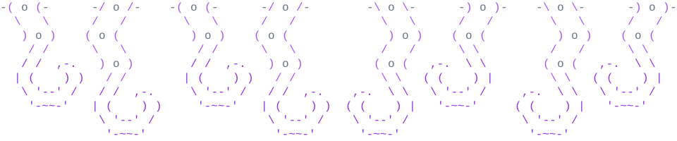

<p align="center">
  <a href="https://github.com/uHappyLogic/gurita-claude/tree/traffic-data">
    
  </a>
  <a href="https://github.com/uHappyLogic/gurita-claude/tree/traffic-data">
    
  </a>
</p>

# Gurita for Claude Code

Gurita brings all the important questions up to be decided upfront, so you can hand long-running execution to your agent confidently.

This repository is the Claude Code distribution of [Gurita](https://github.com/uHappyLogic/gurita). It carries the built Claude Code plugin tree exactly as a Gurita release published it: the `.claude-plugin/` marketplace and manifest beside the plugin's skills, agents, and shared procedures, which makes it the recommended source to add as a marketplace.

> **Generated — do not edit.** Every file on `main`, this README included, is rendered from the sources of [uHappyLogic/gurita](https://github.com/uHappyLogic/gurita) by its host build and published verbatim by each Gurita release; nothing here is edited by hand, and a change made here would be overwritten by the next release. The repository's only other branch, `traffic-data`, is not built from anything and no release touches it — the traffic workflow this tree carries, which runs only in this repository and never in an installed copy, writes its per-day data file and badge SVGs there daily for the two badges above this page's title as well as for the adoption table in the root repository's README, and its own daily fetch of that branch counts as one unique clone a day in the clones badge. Issues are disabled in this repository on purpose — report problems and propose changes as issues and pull requests at [uHappyLogic/gurita](https://github.com/uHappyLogic/gurita), never here.

## Installation

Gurita has two runtime prerequisites: **git**, with your project root inside a git work tree that every skill commits into, and a **Python 3.9 or later** interpreter that answers as `python3` on your PATH. The skills drive the plugin's stdlib-only Python tools with it (no packages to install), and `/define-mission-goal` checks both each time it defines a mission, git first, stopping with the remedy before anything is written when either is missing.

### Claude Code

In Claude Code, add the `gurita-claude` marketplace and install the plugin from it:

```
/plugin marketplace add uHappyLogic/gurita-claude
/plugin install gurita@gurita
```

### Bootstrap your project

Then, in your project root, add the mission workflow guidance to `CLAUDE.md` once:

```
/init-mission-base-workflow
```

Run `/init` to document your project — its domain context, working conventions, available tools, and how work is verified as done — in `CLAUDE.md`, so the skills can read that environment context.

## Source

Built from [uHappyLogic/gurita](https://github.com/uHappyLogic/gurita) at release tag [`2.1.0`](https://github.com/uHappyLogic/gurita/releases/tag/2.1.0), whose release page carries the notes for this version. The exact source commit this tree was built from is recorded in the body of this repository's `Release: 2.1.0` commit.

## License

MIT — see [LICENSE](LICENSE).
